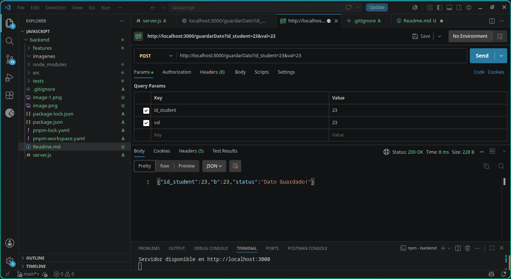
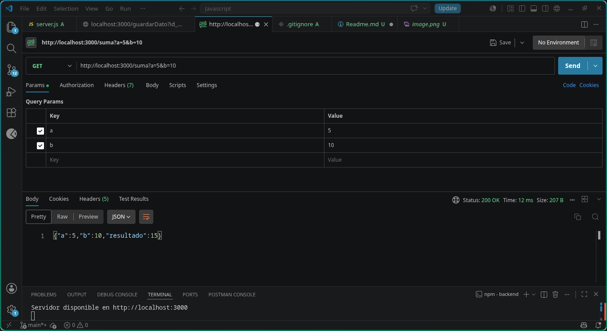

# Backend + Wireshark

Entrega de ejercicio de desarrollo con un backend de ejemplo y los endpoints "/suma" de tipo GET y "/gudarDato" de tipo POST

Ejemplo de endpoint guardarDato:
> http://localhost:3000/guardarDato?id_student=23&val=23

Ejemplo de endpoint suma:
> http://localhost:3000/suma?a=5&b=10

En el proyecto se usa pnpm porque tuve varios problemas con npm ya que no me descargaba las dependecias correctamente en Arch Linux.

Por lo tanto se usa pnpm para ejecutar vitest y cucumber y node para levantar el backend.

Para ejecutar el proyecto usar:
> npm start

Para los test unitarios de vitest:
> npm test

o

> pnpm exec vitest

Para los test unitarios de cucumber:
> npm test2

o

> pnpm exec cucumber-js