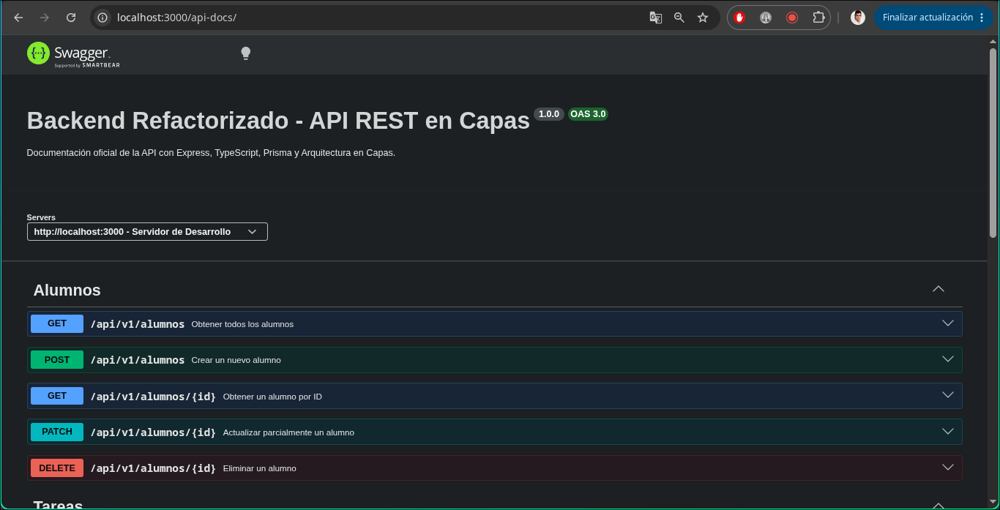

# API Backend Modular en Node.js & TypeScript

Este proyecto implementa una API RESTful robusta estructurada bajo una **Arquitectura en Capas** estricta, utilizando **TypeScript (ESM)**, **Express**, persistencia con **SQLite**, y una completa suite de pruebas automatizadas que incluye **Pruebas Unitarias con Mocks (Vitest)** y **Pruebas de Comportamiento BDD (Cucumber / Gherkin)**.

Ahora se incorporo Swagger para ver los endpoints e interactuar con ellos.

En local, se accede desde http://localhost:3000/api-docs/

Ademas, se agrego persistencia con Prisma como ORM con PostgreSQL. Para levantar la base de datos usar el archivo de docker compose con el comando correspondiente (docker-compose up -d).

---

## 🛠️ Tecnologías y Stack
* **Runtime:** Node.js
* **Lenguaje:** TypeScript (ESM con extensiones explícitas `.js`)
* **Framework Web:** Express
* **Base de Datos:** SQLite (`better-sqlite3`)
* **Testing Unitario:** Vitest (con mocks de repositorios)
* **Testing BDD:** Cucumber.js (@cucumber/cucumber)
* **Gestor de Paquetes:** pnpm

---

## 📐 Arquitectura del Proyecto
La aplicación sigue estrictamente el principio de separación de responsabilidades mediante una arquitectura en capas:

Ruta (Router) ──> Controlador (Controller) ──> Servicio (Service) ──> Repositorio (Repository) ──> Base de Datos (SQLite)

Router: Mapea los verbos y endpoints HTTP hacia los controladores correspondientes.

Controller: Maneja la integridad de la petición HTTP, códigos de estado y validación básica de tipos y formas de datos (req.body, req.params).

Service: Contiene la lógica de negocio pura y las reglas de validación independientes de la infraestructura (por ejemplo, unicidad de emails).

Repository: Encapsula de forma exclusiva todas las consultas SQL hacia la base de datos SQLite.

---

# 📦 Entidades y Operaciones CRUD
El sistema administra dos entidades principales con soporte para operaciones completas de Creación, Lectura (Todos y por ID), Actualización y Eliminación (ABM / CRUD):

1. Tareas (/tareas)
* GET /api/v1/tareas: Obtiene el listado completo de tareas.

* GET /api/v1/tareas/:id: Busca una tarea específica por su ID.

* POST /api/v1/tareas: Crea una nueva tarea (valores por defecto: prioridad y estado de completado).

* PATCH /api/v1/tareas/:id: Actualiza parcialmente una tarea.

* DELETE /api/v1/tareas/:id: Elimina una tarea (Retorna HTTP 204 No Content).

2. Alumnos (/alumnos)
* GET /api/v1/alumnos: Obtiene el listado completo de alumnos.

* GET /api/v1/alumnos/:id: Busca un alumno específico por su ID.

* POST /api/v1/alumnos: Registra un nuevo alumno (Valida regla de negocio de email único).

* PATCH /api/v1/alumnos/:id: Actualiza los datos de un alumno validando la unicidad del email.

* DELETE /api/v1/alumnos/:id: Da de baja a un alumno del sistema.

---

# 🧪 Suite de Pruebas (Testing)
El proyecto cuenta con validaciones automatizadas para garantizar la calidad del código:

2. Pruebas de Comportamiento BDD (Cucumber / Gherkin)
Define los flujos de negocio en lenguaje natural utilizando archivos .feature y step definitions conectados a mocks en memoria para una ejecución rápida y aislada.

## Comando de ejecución:

> pnpm test2

# 🚀 Guía de Instalación y Ejecución
1. Clonar el repositorio e instalar dependencias
>git clone <URL_DE_TU_REPOSITORIO>
 
>cd <NOMBRE_DE_LA_CARPETA>
 
>pnpm install
2. Ejecutar la aplicación en modo desarrollo (con hot-reload)

> pnpm dev

(Esto levantará el servidor en http://erra... o el puerto configurado y generará automáticamente el archivo de base de datos database.sqlite)

3. Ejecutar las pruebas

Tests BDD (Cucumber):
>pnpm test2